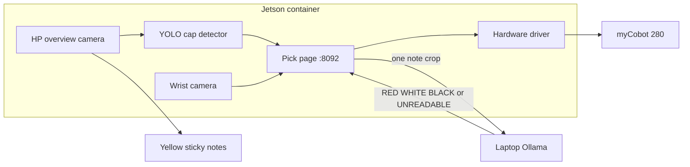
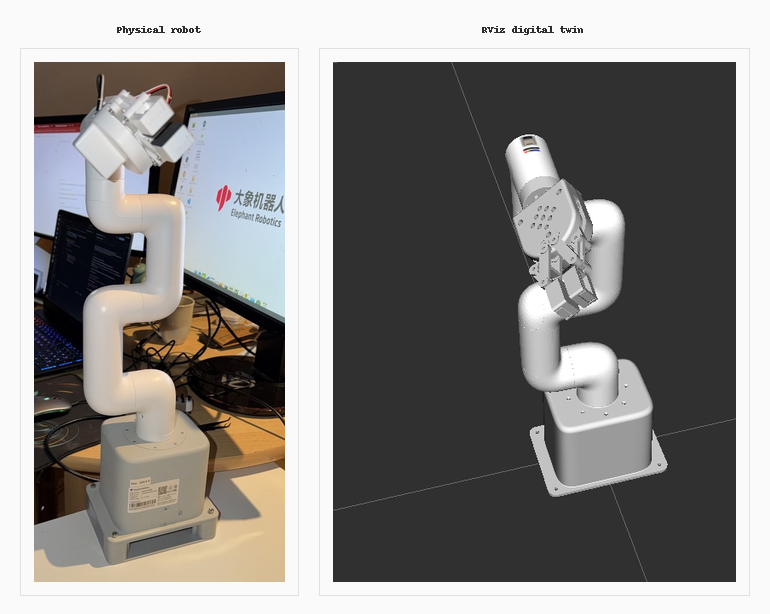

# mycobot_humble

Guarded ROS 2 Humble cell for an Elephant Robotics myCobot 280
Jetson Nano. The arm picks a red, black, or white bottle cap and
drops it on the sticky note whose word matches that color. The notes
can be shuffled. The laptop reads the handwriting. The Jetson keeps
the camera position and moves the arm.

Physical motion is off until a launch turns a gate on. The pick
launch is the one that moves the real arm.

## Phase status

| Phase | What it added | Status |
| --- | --- | --- |
| 1 | Guarded serial driver, dry-run services, stop | Complete |
| 2 | URDF digital twin in RViz, driven by live joints | Complete |
| 3 | Planning-only MoveIt, collision checking, no execution | Complete |
| 4 | Two cameras, YOLO caps, click calibration, physical pick | Complete |
| 5 | Wrist lock on the cap, sticky-note drops, joint-limit halt | In use |

Phase 3 never executes a trajectory. Phase 4 and 5 do, through the
hardware services, not through MoveIt.

## Machines

| Machine | Role |
| --- | --- |
| Jetson Nano, aarch64, about 4 GB RAM | Arm, both cameras, ROS 2, pick page |
| Laptop with an NVIDIA GPU | Reads one sticky-note photo and returns one word |
| Same LAN, `ROS_DOMAIN_ID` 0, `ROS_LOCALHOST_ONLY=0` | DDS between Jetson and a laptop RViz session |

The Jetson cannot run the vision-language model. The tested laptop
GPU is an NVIDIA GeForce RTX 5070 Laptop (8 GB class). The model is
Qwen3-VL 2B, Q4, about 1.6 GB. The first image load took about 15
seconds. Later notes are faster while Ollama keeps the model loaded.

Tested addresses, both from DHCP, so check them after a reboot:

| Machine | Address used in this cell |
| --- | --- |
| Jetson | `192.168.178.154` |
| Laptop running Ollama | `192.168.178.187` |

## How the cell is wired



The laptop never chooses a table coordinate. The Jetson finds each
yellow rectangle, asks what that crop says, and converts the middle
of the matching rectangle into millimetres with the click calibration.

```mermaid
sequenceDiagram
  participant Page as Pick page
  participant Arm as Arm
  participant Over as Overview camera
  participant Wrist as Wrist camera
  participant Laptop as Laptop reader
  Page->>Arm: Park clear of the camera
  Over-->>Page: Cap box
  Page->>Arm: Move above the cap
  Wrist-->>Page: Cap centre during descent
  Page->>Arm: Nudge, then close
  Page->>Arm: Park again
  Over-->>Page: Yellow note rectangles
  Page->>Laptop: One crop per note
  Laptop-->>Page: The word
  Page->>Arm: Move to that note and open
```

## What was built

### 1. Guarded hardware

`mycobot_hardware` talks to the arm on `/dev/ttyTHS1` at 1 000 000
baud through `pymycobot` 4.0.4. One process owns the port. The lock
file is `/tmp/mycobot_ttyTHS1.lock`.

Services validate a command before anything is sent. Dry runs use
`execute: false`. Physical motion needs the matching gate
(`motion_enabled`, `multi_joint_motion_enabled`,
`gripper_motion_enabled`, `coord_motion_enabled`) and `execute: true`.
`hardware.yaml` leaves every gate false. The pick launch turns the
gates it needs on for that process only.

Checked on the real arm: single joint, six-joint pose, gripper open
and close, rejected gates, the 5° step cap, stop during motion, and
timeout stop. An 8° J1 move was stopped after about 1°. A 0.1 s
timeout also stopped cleanly, with `error=0` and `moving=0`.

Gripper values `253`, `254`, and `255` are ignored. They appear
before the first real move and are not positions. After a real open,
the tested gripper reported about 98 open and about 1 closed. A hold
on a cap is a jaw value from 12 to 86.

### 2. Digital twin

The same `/joint_states` stream drives the adaptive-gripper URDF in
RViz on a laptop. The Jetson publishes joints and TF. The laptop
runs RViz only. Do not start a second `robot_state_publisher`.

<p align="center">
  
</p>

### 3. Planning-only MoveIt

`mycobot_280jn_physical_moveit_config` plans with OMPL and KDL on the
live joint state. `allow_trajectory_execution` and
`moveit_manage_controllers` stay false. There is no
`FollowJointTrajectory` server. A green plan in RViz does not move
the arm.

Collision meshes cover the seven arm links. Connected links are in
the SRDF allowed-collision matrix. This was validated as
collision-free planning only. It is not the pick path.

### 4. Seeing the caps

Two USB cameras are passed into the container by USB id, because the
host `/dev/videoN` numbers swap:

| Camera | USB id in `compose.yaml` | Inside the container | ROS namespace |
| --- | --- | --- | --- |
| HP 320 overview, fixed over the table | `usb-SunplusIT_Inc_HP_320_FHD_Webcam_...-video-index0` | `/dev/video0` | `/overview_camera` |
| Wrist camera on the gripper | `usb-Generic_USB_2.0_Camera_...-video-index0` | `/dev/video1` | `/wrist_camera` |

Both publish 640×480 MJPEG at 15 Hz. The overview image is rectified.
YOLO (`models/best.pt`, trained from the bottle-cap set) runs on CPU
at image size 640, every third frame. Classes are `red_cap`,
`black_cap`, and `white_cap`. The detector keeps one box per class,
the highest score. A second black cap is ignored. A fourth color is
ignored.

The offline model check on 20 images was precision 0.906, recall
0.914, mAP50 0.913, mAP50-95 0.693.

An early homography used an ID-1 card (85.6 × 54.0 mm) in a small
patch of the image. Picks do not use that card mapping. They use an
affine fit from clicked pixels to the live tool pose. Five spots must
span at least 100 px in `u` and 80 px in `v`, stay 50 px and 25 mm
apart, and leave each residual under 8 mm. A held-out check click
must land within 12 mm. The current fit residuals on the accepted
file are about 2–6 mm. The check click is not part of the fit.

The pick page is `http://<jetson>:8092`.

| Page | Use |
| --- | --- |
| `/` | Pick one color, pick all, stop, return, zero |
| `/calibrate` | Click fit spots and accept the mapping |
| `/wrist` | Wrist image and the green cap mark |
| `/aruco` | Print `DICT_4X4_50` id 0. Used for calibration, not for drops |

### 5. Picking a cap

The arm parks at 130, 130, 200 mm so it is out of the overview. The
cap centre is the median of five views. The arm travels at Z = 150 mm,
then descends in 12 mm steps from there to the table height plus a
small clearance. Sideways moves happen at travel height so the arm
does not sweep the table.

The overview is blocked by the gripper during the descent, so wrist
guidance stays on. The wrist search ignores the left 18% of the frame
(the gripper body). The yellow cross is at 30% of the width and 50%
of the height, which is the open-jaw grasp point on this mount, not
the middle of the picture.

Wrist detection, after the false marks were removed:

| Color | What counts as the cap |
| --- | --- |
| Red | Hough circle, red disc saturation at least 210, pale logo in the middle, pale ring. Wood is too dull and is rejected. |
| Black | Dark disc, gray at most 25, bright low-saturation ring |
| White | Hough circle whose middle is the red logo, not a bright patch of table |

The green mark is the fresh centre. It may move only 28 px, and the
radius must stay within 0.65–1.45 of the lock. During descent a same
size disc may be followed a little further, because a nudge shifts
the cap in the image. The preview does not jump to a distant blob.
Three misses, or a nudge that walks more than 12 px the wrong way,
and that step finishes on the overview aim.

The jaw closes at speed 15. Values 12–86 mean the pads stopped on a
cap. The arm then lifts to 150 mm.

### 6. Dropping on the written note

Fixed colour spots in `table_calibration.yaml` are not used for the
drop. After the lift, the arm parks again and the overview looks for
yellow notes (hue 15–40, nearly square, about 95 px on the tested
frame). Each crop is sent alone.

The laptop is asked:

```text
Look at this sticky note. Reply with only RED, WHITE, BLACK, or UNREADABLE.
```

The Jetson maps those words onto the cap color. `UNREADABLE`, a
duplicate word, a missing note, or a laptop that cannot be reached
cancels the drop. Sending the whole table as one photo was tried and
rejected: the model returned colors in the wrong left-to-right order.
The camera keeps the order. The model only names a crop.

The drop point is the middle of that yellow box, projected with the
click fit, then checked against the pick box: X from 50 to 280 mm,
Y from −200 to 200 mm. Firmware rejects X past about 281 mm, so the
software box stops at 280. The wrist camera is not used on the way
down to the note.

Empty `note_reader_url` falls back to Tesseract on an ink image.
Handwritten notes, including upside-down words, were not reliable
that way. Tesseract remains installed for that fallback. The running
cell uses the laptop.

### 7. Stopping before a joint limit

Joint limits in degrees, with a 2° margin inside them:

| Joint | Limit |
| --- | --- |
| J1 | ±168 |
| J2 | ±140 |
| J3, J4 | ±150 |
| J5 | −155 to 160 |
| J6 | ±180 |

A coordinate move is not sent when `solve_inv_kinematics` has no
solution, or when a solved joint sits inside the margin. During a
move, a live joint that reaches the safe limit calls `stop`. A bad
angle read does not stop the arm by itself. Joint steps stay capped
(5° in the safe launch, 10° in the pick launch).

## Packages

### Installed in the Docker image

From `Dockerfile`, on `ros:humble-ros-base-jammy`:

| Package | Why it is there |
| --- | --- |
| `python3-pip` | Install the pinned Python packages |
| `python3-colcon-common-extensions` | Build the workspace |
| `python3-setuptools` | Ament Python packages |
| `python3-serial` | Serial port used by pymycobot |
| `ros-humble-geometry-msgs` | Poses and vectors |
| `ros-humble-image-transport-plugins` | Compressed camera images |
| `ros-humble-sensor-msgs` | Joint state and images |
| `ros-humble-std-srvs` | Trigger services |
| `ros-humble-usb-cam` | Both USB cameras |
| `tesseract-ocr` | Fallback note reader when no laptop URL is set |
| `pymycobot==4.0.4` | Official arm API |
| `packaging==24.2` | Required by that pymycobot pin |

A change to this list needs `docker compose build`. A change to a
Python script does not. The pick script and the hardware node are
installed with `--symlink-install`, so restarting the launch loads
the new file.

### Also required inside the container

These are used by the vision package and are not all copied into the
image by the Dockerfile. A new container needs them before the first
camera or pick launch:

```bash
apt-get update && apt-get install -y --no-install-recommends \
  ros-humble-cv-bridge \
  ros-humble-image-proc \
  ros-humble-vision-msgs \
  ros-humble-robot-state-publisher \
  python3-numpy \
  python3-opencv \
  python3-pytest

python3 -m pip install --no-cache-dir ultralytics
```

`rviz2` is not part of the Jetson image. Run RViz on the laptop.

The weights file `mycobot_ws/src/mycobot_vision/models/best.pt` has
to be present. It is the bottle-cap YOLO model. It is not downloaded
by the Dockerfile.

### ROS packages in this repo

| Package | Build type | What it contains |
| --- | --- | --- |
| `mycobot_interfaces` | CMake | `MoveJoint`, `MoveJoints`, `SetGripper` |
| `mycobot_description` | ament_python | URDF, meshes, RViz launch |
| `mycobot_hardware` | ament_python | Serial driver and launches |
| `mycobot_vision` | CMake | Cameras, YOLO, calibration, pick page |
| `mycobot_280jn_physical_moveit_config` | CMake | Planning-only MoveIt, built on the laptop |

Build the Jetson packages once:

```bash
cd /root/mycobot_ws
source /opt/ros/humble/setup.bash
colcon build --symlink-install --packages-select \
  mycobot_interfaces \
  mycobot_description \
  mycobot_hardware \
  mycobot_vision
source install/setup.bash
```

### Laptop reader

Ollama 0.31.1 was used. The model id is
`hf.co/Qwen/Qwen3-VL-2B-Instruct-GGUF`.

```bash
# Leave this window open. Closing it stops the reader.
OLLAMA_HOST=0.0.0.0:11434 ollama serve
```

```bash
ollama pull hf.co/Qwen/Qwen3-VL-2B-Instruct-GGUF
ollama list
```

The server must listen on all interfaces. The default
`127.0.0.1:11434` refuses the Jetson. If `ollama serve` says the
address is already in use, a server is already running. If that
server was started before the pull, it can show `models=0` and the
Jetson gets HTTP 404. Pull again against the server that is actually
listening, then check from the Jetson:

```bash
curl -s http://<laptop>:11434/api/tags
```

The reply must include the Qwen model and a vision capability.
`ollama` here was not a systemd user service. After a reboot, start
`ollama serve` again with `OLLAMA_HOST=0.0.0.0:11434`.

## First-time setup

On the Jetson host:

```bash
cd ~/mycobot_humble
docker compose build
docker compose up -d
docker exec -it mycobot-humble-jetson bash
```

Inside the container, install the extra vision packages from the
section above, then build and source the workspace. New shells source
ROS 2 and the workspace from `.bashrc`.

Accept a calibration on `http://<jetson>:8092/calibrate` before the
first pick. Five fit clicks plus one check click are required. Restart
is not required after Accept. The pick node reloads that file.

## Run the pick cell

Stop any other `state_publisher` first. Only one process may hold
the serial port.

```bash
docker exec -it mycobot-humble-jetson bash -lc \
  'source /opt/ros/humble/setup.bash && source /root/mycobot_ws/install/setup.bash && ros2 launch mycobot_hardware pick_place.launch.py use_wrist_guidance:=true'
```

Open `http://<jetson>:8092`. Leave the laptop `ollama serve` window
open. If the laptop address changed:

```bash
ros2 launch mycobot_hardware pick_place.launch.py \
  use_wrist_guidance:=true \
  note_reader_url:=http://<laptop>:11434
```

An empty `note_reader_url` uses Tesseract.

On a good black drop the log contains all of these, in order:

```text
Laptop read a note as 'BLACK'.
Sticky note for black at <x>, <y> mm (pixel <u>, <v>).
Move above the drop
Open gripper
```

`Laptop read a note as 'BLACK'` without the sticky-note line means
the drop was refused. The words were read. The arm was not sent.

### Release the motors

Refused while a guarded move is still active.

```bash
ros2 service call /mycobot/release_servos std_srvs/srv/Trigger "{}"
ros2 service call /mycobot/focus_servos std_srvs/srv/Trigger "{}"
```

`focus_servos` holds the arm again and clears the software stop latch.

### Other launches

| Launch | Moves the arm? | Use |
| --- | --- | --- |
| `mycobot_hardware state_publisher.launch.py` | No | Feedback and dry-run services |
| `mycobot_hardware physical_bringup.launch.py` | No | Feedback plus robot state for RViz |
| `mycobot_280jn_physical_moveit_config physical_planning.launch.py` | No | Plan on the laptop |
| `mycobot_hardware pick_place.launch.py` | Yes | The pick cell |

## Safe hardware launch

```bash
ros2 launch mycobot_hardware state_publisher.launch.py
ros2 param get /mycobot_state_publisher motion_enabled
ros2 param get /mycobot_state_publisher multi_joint_motion_enabled
ros2 param get /mycobot_state_publisher gripper_motion_enabled
```

All three report `False` in that launch.

| Topic | Type | Meaning |
| --- | --- | --- |
| `/joint_states` | `sensor_msgs/JointState` | Six arm joints plus `gripper_controller` |
| `/mycobot/tool_pose_raw` | `std_msgs/Float64MultiArray` | `x y z rx ry rz`, millimetres and degrees |

| Service | Type | Meaning |
| --- | --- | --- |
| `/mycobot/status` | `std_srvs/Trigger` | Power, error, motion |
| `/mycobot/stop` | `std_srvs/Trigger` | Stop the arm and release the gripper |
| `/mycobot/release_servos` | `std_srvs/Trigger` | Motors off so the arm can be posed by hand |
| `/mycobot/focus_servos` | `std_srvs/Trigger` | Motors on again |
| `/mycobot/move_joint` | `mycobot_interfaces/MoveJoint` | One joint |
| `/mycobot/move_joints` | `mycobot_interfaces/MoveJoints` | Six joints |
| `/mycobot/set_gripper` | `mycobot_interfaces/SetGripper` | `0` open, `1` close |

```bash
ros2 service call /mycobot/status std_srvs/srv/Trigger "{}"
ros2 service call /mycobot/stop std_srvs/srv/Trigger "{}"
```

A healthy idle status contains `connected=1, power=1, error=0, moving=0`.

Dry run, nothing is sent:

```bash
ros2 service call /mycobot/move_joint mycobot_interfaces/srv/MoveJoint \
  "{joint_id: 1, target_degrees: 3.0, speed: 10, execute: false}"
```

Physical execution is a separate process with one gate set true, and
the request must set `execute: true`. Stop that process when the test
is over and return to the safe launch.

Default gates and limits live in
`mycobot_ws/src/mycobot_hardware/config/hardware.yaml`. The pick
launch overrides speed, step, timeout, and the coordinate gate for
its own process. It does not change the file.

## Safety

- Bolt or clamp the base. Keep people out of the workspace.
- Keep the power switch in reach. `/mycobot/stop` is software only.
- Start with a small motion. The pick launch uses speed 12 for travel
  and speed 5 for the descent.
- The pick box is X 50–280 mm and Y −200–200 mm. A note outside that
  box is not a place target.
- One hardware node at a time. A second one fails the serial lock
  instead of sharing the port.
- Do not run MoveIt execution against this arm. Planning stays
  display-only.

## Troubleshooting

| What happened | Why | What to do |
| --- | --- | --- |
| `ros2: command not found` | Shell did not source the setup files | `source /opt/ros/humble/setup.bash` and `source /root/mycobot_ws/install/setup.bash` |
| Container is not running | Compose was not started | `docker compose up -d` from `~/mycobot_humble` |
| Serial port already owned | Another `state_publisher` holds `/tmp/mycobot_ttyTHS1.lock` | Stop that process. `pgrep -af state_publisher` |
| `connected=0` | Power, Atom link, or the wrong device | Check power and `/dev/ttyTHS1` |
| Gripper reports 253–255 | No real feedback yet | Ignore it. Open once under a guarded command |
| Movement rejected | A gate is false, the step is over the cap, or the joint is inside the 2° margin | Read the service message. Do not raise the gate in `hardware.yaml` |
| Python edit did nothing | The running launch still has the old process | Restart the launch. Do not rebuild the image for a `.py` change |
| New apt package missing | It is not in the image until a rebuild | Add it to the Dockerfile only if it must be in every container, then `docker compose build` |
| `focus_auto` unknown control | The HP camera has no such V4L control | Harmless. The wrist camera does accept `focus_auto` |
| Overview and wrist views are swapped | Host `/dev/video0` and `/dev/video1` swapped | Trust the USB ids in `compose.yaml`, not the host numbers |
| RViz has no TF | Bringup is down, or two robot state publishers are fighting | Run `physical_bringup.launch.py` on the Jetson only |
| `rviz2` missing on the Jetson | The image is hardware-only | Run RViz on the laptop |
| Green circle on the floor, a cable, a hat, or the red jaw ring | Early wrist masks treated those as discs | Current rules require a cap-sized disc and the logo or the pale ring. Restart the launch if an old process is still drawing |
| Green circle beside the cap | The lock was wide enough to sit on the table, or a blended stale point | The lock is 28 px and the preview draws the fresh centre |
| Wrist never sees the cap | The cap is in the ignored left strip, or it is cut off at the frame edge | The descent finishes on the overview aim after three misses. Shift the approach or the cap |
| Second black cap is never picked | One box per class | Only the higher score is tracked. Use one cap of each color |
| Note photo returns Red, White, Black in the wrong order | The model was given the whole table | Send one crop. That is what the pick node does |
| `Connection refused` on port 11434 | Ollama is on localhost | Restart with `OLLAMA_HOST=0.0.0.0:11434` |
| `ollama serve` address already in use | A server is already up | Use that server. Do not start a second one |
| Jetson `POST /api/chat` returns 404 | The listening server has no model | `ollama list` in that environment, pull again if the model is missing |
| First note takes a long time | The model is loading, about 1.5 GB and about 15 s | Wait. Do not close the serve window. The reader allows 60 s |
| Log says the color, then the gripper opens at 130, 130, 200 | The note pixel projects outside X 50–280 or Y −200–200. The place is refused, and the failed-pick path then opens the gripper at the park | Move that note into the calibrated, reachable band. A black note to the right of a red note at about X = 254 mm crosses 280 mm |
| Cap opens near the table but misses the paper | The word was right. The click fit does not cover the bottom of the picture. Tested notes sat near pixel `v` 314. The clicks sit near `v` 90–190 | Put the notes in the same image band as the fit clicks, or add fit clicks on the notes and accept again |
| Two notes read as the same word | The drop is refused on purpose | One note per color. A second BLACK note will not take the second black cap |
| `UNREADABLE` | The crop was not one of the three words | Rewrite the note as a single word: RED, WHITE, or BLACK |

## Known limits

- The wrist camera corrects the pick. It does not correct the drop.
- Notes outside the clicked pixel band get a guessed millimetre point.
  On the tested table the red note at pixel 278, 314 was inside the
  box (about 254, −78 mm) and still missed the paper. The black note,
  further right, was outside X = 280 mm, so the arm never started
  that move.
- A refused place still ends in the failed-pick cleanup, which opens
  the gripper. That is why a black miss drops the cap at the park.
- One cap of each color. Two black caps share one BLACK note, and
  the detector only tracks one of them.
- Ollama is a foreground process. It does not survive a closed
  terminal or a reboot until it is started again.
- The model context used here was 4096 tokens. One note crop fits.
  The whole frame does not, and it orders the words wrongly anyway.

## Project layout

```text
mycobot_humble/
├── compose.yaml
├── Dockerfile
├── README.md
├── docs/
└── mycobot_ws/
    └── src/
        ├── mycobot_hardware/
        │   ├── config/hardware.yaml
        │   ├── launch/pick_place.launch.py
        │   ├── mycobot_hardware/state_publisher.py
        │   └── test/test_joint_limit_halt.py
        ├── mycobot_interfaces/
        ├── mycobot_description/
        ├── mycobot_280jn_physical_moveit_config/
        └── mycobot_vision/
            ├── config/table_calibration.yaml
            ├── config/yolo_detector.yaml
            ├── launch/cameras.launch.py
            ├── models/best.pt
            ├── scripts/pick_place.py
            ├── scripts/yolo_detector.py
            └── test/
```

Offline checks, with no arm motion:

```bash
python3 -m pytest \
  mycobot_ws/src/mycobot_vision/test/test_sticky_notes.py \
  mycobot_ws/src/mycobot_vision/test/test_wrist_lock.py \
  mycobot_ws/src/mycobot_hardware/test/test_joint_limit_halt.py
```
